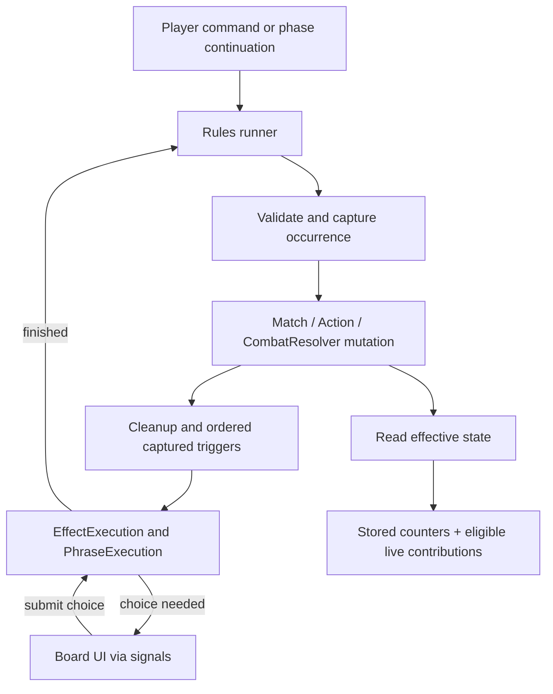

# Implementation scheme: triggers and state rules

Updated 2026-09-26. M2 now implements a runner for captured triggers, commands,
optional/costed choices, atomic built-in resource bundles and phase/combat
continuations. Conditions and state queries share RuleContext. See
[M2_EXECUTION.md](M2_EXECUTION.md) for actual APIs and limitations.
[TRIGGER_ROADMAP.md](TRIGGER_ROADMAP.md) gives the event-handler, matcher, capture,
dispatch, and parity work as an incremental technical roadmap.

This remains the broader M2/M3 design reference. General contributions, auras,
lifetimes, schedules and saveable continuations below are proposals, not existing
APIs. Read the implementation document rather than treating all design sketches
as completed work.

## 1. Recommended approach

Use **one deterministic rules runner for events and pending work**, and
**read-only queries for continuous state**. Use Godot signals to connect the
runner to presentation and choices, rather than connecting every card directly
to mutation signals.

| Approach | Benefit | Problem / decision |
| --- | --- | --- |
| Each card connects to action signals | Easy first example | Connection order becomes rule order; nested emissions can advance turns during unresolved choices. Do not use as the rules scheduler. |
| Reevaluate every rule every frame | Simple polling | Repeated actions, frame-dependent timing, and unnecessary work. Reject for triggers. |
| Explicit event runner + live state queries | Timing, pauses, history, and ownership stay visible | Requires a small continuation model. Recommended. |

Signals remain useful: `phrase_started`, `finished`, `phase_changed`, and
`state_changed` already describe useful boundaries. A signal listener may show
state or submit a command; it must not bypass the runner to mutate the match.
`call_deferred` can yield presentation work, but must never define game order.



## 2. Existing code and the specific gaps

| Existing entry | Keep | Required extension |
| --- | --- | --- |
| [EffectEvent](../scripts/effects/effect_event.gd) | Action, stage, participant references, copied details, occurrence ID, turn/phase/controller metadata | Typed historical fields for movement, previous control, and last-known source data. |
| [Effect.EventPhrase](../scripts/effects/effect.gd) | Matching-only `observe(action, subject, target, kinds, stage)` and legacy verb-backed matching | Match phase/death/attack-family events with richer patterns; retain a compatibility path. |
| [EffectExecution](../scripts/effects/effect_execution.gd) | Cost, ordered consequences, phrase signals, results | Acceptance before payment, captured-trigger entry, execution origin, safe runner continuations. |
| [PhraseExecution](../scripts/effects/phrase_execution.gd) | Selection, revalidation, exactly-once commits | Preserve current domain adaptation and UI behavior. |
| [StateModifier](../scripts/effects/state_modifier.gd) | Silent attached modifier contribution; Selector, Condition, and always-on forms | Recipient/provenance model and later non-modifier contributions. |
| [UnitInfo](../scripts/model/unit_info.gd) | Counter identities and derived modifier getters | Shared queries for aura modifiers, passive flags, and action adjustments. |
| [Match](../scripts/runtime/match.gd) | Authoritative IDs, ownership, deployment, phases, connected RulesRunner | Route mutations through full capture/mutation/cleanup boundaries; replace synchronous turn advancement with continuations. |
| [CombatResolver](../scripts/combat/combat_resolver.gd) | Attack capture and damage rules | Resume between rule boundaries without losing attack/batch position. |

Today `Match.action_event` is generally emitted after mutation. `Match.defeat`
already clears the live hex before publishing Die, and `start_turn` moves from
activation directly to Action. Merely adding signal subscribers cannot supply
pre-mutation death matching or suspend those operations correctly.

`EffectExecution.start()` currently matches its event again against live state.
A previously captured trigger needs a runner-only start path which uses the
recorded match result, while still validating its definition, payment and action
legality. Otherwise moving or dying between capture and execution can erase a
legitimate occurrence.

## 3. Small object model

Most names below remain proposed rather than current constructors. The existing
implementation uses `Effect.EventPhrase`, `Condition`, `StateModifier`, and
`RulesRunner`; add related records only when a concrete card requires them.

| Object / responsibility | Definition or runtime data |
| --- | --- |
| `EventPattern` | Reusable action/family, stage and participant predicates; no mutation Callable required. |
| `Condition` | Reusable read-only Boolean test over a supplied context; Wounded/All/AnyOf/Not currently exist. |
| `ContinuousEffect` | Source condition, recipient selector, per-recipient condition, contributions, source scope. |
| `Contribution` | Modifier delta, passive grant, named action parameter adjustment, or trigger-eligibility policy. |
| `RulesRunner` | Match-owned event queue, occurrence de-duplication, deterministic deployed-source scan, automatic ALL triggers, and drain guard; phase/combat continuations remain planned. |
| `CapturedTrigger` | Occurrence ID, source ID, definition ID, captured controller, ordering key, historical bindings. |
| `StoredContribution` | Concrete grant ID, recipient, payload, provenance and lifetime; independent of an aura scan. |
| `ScheduledConsequence` | Concrete captured work, selected player and strictly future phase boundary, consumed status. |

Definitions remain reusable. Pending candidates, chosen targets, payment state,
and sequence position belong only to executions. Use `TargetRef` identities;
ordinary references never acquire cached owner/location fields.

Initially scan eligible sources in stable order when an occurrence happens.
The board is small; an event subscription index is an optimization to add only
after measurement. Both approaches must produce the same ordered trigger list.

## 4. Event occurrence and trigger timing

### Boundary protocol

1. Validate the proposed operation without mutation. A rejected command has no
   committed occurrence and consumes no lifetime.
2. Capture a unique occurrence and its historical facts. For a declaration,
   capture matching sources before its mutation. For a resolved event, match at
   that resolution boundary using the completed outcome. Die explicitly captures
   eligible death rules and last-known facts before removing deployed presence.
3. Determine matching `until` grants and exclude them before applying the event.
4. Apply the authoritative mutation once, including any required death handling.
5. Remove matching `removed-after` grants after they have participated, before
   followups. Refresh derived-state presentation when the boundary is stable.
6. Release captured trigger work at the enclosing bundle boundary, in rule order.
7. Resume remaining action, combat or phase work only when its children finish.

Do not expire grants speculatively: validation must cover the complete atomic
operation, or expiry must be staged and committed only with successful mutation.
An event canceled before application consumes neither lifetime. Existing paid
costs and completed sequence steps still remain after later consequence failure.

An event record should include `event_id`, parent occurrence/bundle ID, action,
stage, subject, target, controller, turn/phase serial, and outcome. Capture origin,
destination, previous control, last-known source facts or attack data when a
rule needs them. Treat captured records as immutable; copying a Dictionary does
not make referenced mutable objects immutable. Prefer typed historical fields
for recurring facts and copy reference identities rather than UnitInfo objects.

Use current Match state for ordinary conditions. Use explicitly named historical
fields for “from opponent control” and death location. Missing history is an
unsupported definition/context error, not permission to read the new position.

### Ordering, batches and nested effects

Preserve the JS reference ordering: active player's sources first, then deck
order, hero preference and stable identity tie-breaks, then printed rule order
([GUERRA_RULES R22](GUERRA_RULES.md#7-rule-language-and-execution)). Encode that
ordering once and test it; do not use connection order or Dictionary iteration.

Use one explicit work list with continuation records. Enqueue an occurrence's
ordered followups ahead of its enclosing continuation. Nested followups finish
before returning to the next sibling; use records rather than recursive signal
callbacks. Verify this trace against the JS runtime when porting each slice.

Respect reference bundle boundaries: capture events as each member mutates,
but hold their triggers until the cost/consequence bundle finishes. Cost triggers
finish before beginning the consequence bundle. A consequence sequence can
pause for choices without releasing its accumulated followups early. On partial
failure, release events for already committed steps; discard unperformed work.
Sequential ALL retains its frozen recipients and per-target legality checks;
bundle deferral does not make ALL simultaneous or atomic.

Track `(event_id, source_id, rule_id, grant_instance_id)` to prevent accidental
duplicate dispatch, including aura-granted rules. A new event can legitimately
trigger the same rule again. Add a diagnostic work limit for runaway chains:
pause with the causal trace, never silently discard effects to finish a turn.

### Representative event contracts

| Occurrence | Capture / result requirement |
| --- | --- |
| Deploy | New unit identity and destination; explicitly include its own on-deploy rules in eligible sources. |
| Die | Departing source's rules and last hex survive capture; defeated identity remains. No general requirement that captured source still be deployed. |
| Move resolved | Record original position/control before movement and destination after movement. General Move still needs implementation. |
| Hit / Wound | Physical contact emits Hit even at zero loss; only positive physical loss emits Wound. Immunity is no contact. |
| Fire | Target and resolved stages remain distinct; queueing is not damage. Miss stays an outcome notification, not invented Hit/Wound. |
| Bash engagement | Distinct occurrence from Bash resolution, needed by Prism Moth. |
| Start / End | One occurrence identifying the phase player; your/opponent patterns compare against captured controller. |

Attack-family matching follows the explicit reference families (R19); do not
infer that every damage operation, including Bomb, belongs to every attack family.

## 5. Choices, payment and turn continuation

Before cost selection/payment, resolve effect-level optionality: activity-costed
triggers are optional unless explicitly mandatory; free/Tireless triggers are
mandatory by default. Explicit policy wins. Optional ALL asks once. Mandatory
effects can still require a target choice and can fail legality/payment.

Keep effect acceptance separate from the existing optional consequence phrase:
asking only after `EffectExecution` has paid the cost is too late. Accepting an
effect does not auto-select its sole CHOOSE_ONE target.

The runner owns one active effect and retains it while the Board observes its
current phrase. `finished` marks work ready; a draining guard prevents a synchronous
signal from starting a second drain. Release the active execution on completion;
keep the existing weak phrase-to-parent reference.

Distinguish player commands, triggered effects and scheduled work explicitly.
The Board must not call `Match.finish_action` once for every triggered effect.
The enclosing command spends its token exactly once under existing payment rules;
trigger token requirements, where applicable, go through an explicit policy.
Do not infer token payment solely from a consequence's Action-free Boolean.

Turn work becomes resumable:

```text
Start recovery (remove one friendly Stun, no activation) -> Start effects -> Action
committed command -> action followups -> Action if tokens remain
otherwise: Combat (Bow/Gore -> Cannon/Bomb -> Fire -> eligible Bash)
         -> End effects -> owner zero-Stun activation / followups
         -> Bash eligibility update / cleanup -> switch player -> Start
```

Store combat group, attack/batch position and phase step. Preserve response
windows and delayed bomb-chain eligibility. A pending choice blocks the next
attack/phase; animations never unblock it. Snapshot eligible combat work as the
current combat rules require so newly queued delayed work cannot resolve early.

Keep hero Start recovery as exactly one runner-owned operation, preserving
self-Stun and removal of one Stun without changing activity. The 2026-10-19
user ruling replaces Start activation with owner-only activation after End
effects/choices; Activate followups finish before cleanup/switch. Do not run
both the old activation loop and a hero effect. Keep sample allowances until format rules
are settled. On match end, stop ordinary pending gameplay; explicitly settle the
terminal/death-trigger policy before enabling cards that depend on post-win work.

## 6. Continuous state rules

### Read-only evaluation

For a queried recipient and stat:

1. Read printed values and stored counters/grants.
2. Scan eligible continuous sources (deployed by default).
3. Test the source condition; resolve its deduplicated recipients.
4. Test the recipient condition separately for each selected recipient.
5. Include each matching contribution once and return the total plus provenance.

Never increment a counter, publish an action, or register another trigger while
reading state. Start with uncached scans. If caching becomes necessary, invalidate
on every relevant authoritative mutation, including changes within ALL/sequence
execution, not just when the UI receives `state_changed`.

Use a small read-only context with source, recipient, event (if relevant), and
explicit historical bindings. Adapt existing selector context access gradually;
keep `TargetResolver` as the sole conversion/validation boundary. A state query
must not need a fake active effect execution permanently.

`Condition` initially needs property comparisons, active/wounded/deployed,
Bash relationships, ANY/NONE/nonempty-ALL, AND/OR/NOT. Empty ANY and ALL are false;
empty NONE is true. A selector/domain error remains an error, not false that NOT
can turn into true. Add conditions only for concrete card requirements.

For an ordinary aura SELF remains its source and RECIPIENT is explicit. For an
attached “selected units have this rule”, rebind the inner rule's SELF to each
recipient while retaining the granting source as provenance. Do not overwrite
phrase SUBJECT or EVENT_TARGET to simulate either binding.

### Contributions and dependencies

| Type | Combination and lifetime |
| --- | --- |
| Physical/magical delta | Add each eligible contribution to the respective permanent and temporary counters; signed values allowed. |
| Passive flag | Printed/stored flag OR any eligible grant. Losing one aura does not erase another grant. |
| Action adjustment | Derive parameters/stickers for a specific action identity; never mutate the shared Verb definition. Capture attack values at the existing declaration boundary. |
| Stored timed grant | Concrete recipient and grant identity; removed by explicit lifetime processing. Numeric action-value grants now capture player/turn cleanup; other output types remain planned. |
| Life/max-life adjustment | Later slice: define effective maximum and clamp actual life at mutation boundaries; a getter must not perform defeat/clamping. |

Preserve `ControlResolver` as the single regional calculation. Keep its implicit
+1 physical exactly once; either retain the current call or migrate it to a
contribution provider and remove that call in the same change. Control strength
never reads physical modifiers.

Prevent recursive derived queries: track the evaluation path and report a cycle
with rule IDs. Do not return a guessed zero or iterate until an arbitrary fixed
point. Begin with observable facts independent of the stat being supplied; defer
mutually dependent grants until their intended semantics are specified.

### Object authoring examples (proposed notation, not runnable GDScript)

```text
Alps Lone Wolf:
  ContinuousEffect(source_when = Deployed(SELF), recipients = Self,
                   recipient_when = Wounded(RECIPIENT), contribution = Physical(+2))

War Temple:
  ContinuousEffect(recipients = FriendlyUnits(SELF),
                   recipient_when = BashingEnemy(RECIPIENT), contribution = Physical(+1))

White Wolf:
  ContinuousEffect(source_when = Deployed(SELF) AND NOT Active(SELF),
                   recipients = AdjacentFriendlyUnits(SELF),
                   contribution = AdjustAction(Bow, damage=+1, range=+1))

Ironhide Boar Pup:
  Trigger(Hit, subject=SELF) -> Sequence(
    ChangeCounter(PropertyOf(SELF, physical), +1),
    ChangeCounter(PropertyOf(SELF, magical), +1))

Needle Peacock:
  Trigger(Wound, subject=SELF) -> Stun(EVENT_TARGET, 1)
```

The first three produce derived values. The last two create normal executions
and persistent mutations. The existing adjacent-to-hero rule remains a regression
example: any number of matching heroes contributes only once per attached rule.

## 7. Lifetimes and scheduling

Keep expiration and future execution separate. `until Hit` affects the next
matching committed Hit before it applies; `removed-after Hit` participates in it,
then disappears before followups. Freeze the matching grant IDs for that boundary
so a new grant created by a followup cannot expire retroactively.

For Jumping Hare, capture movement-origin control, player ID and concrete token
work at movement time. Record a strictly later owner Start serial. Mark scheduled
work claimed before executing it; a pause/resume must not enqueue it again.
Source death does not cancel already captured work unless the rule explicitly
requires it. Revalidate surviving identities at application; never substitute a
new occupant or silently reselect recipients. Schedules intentionally selecting
future recipients must declare that different behavior explicitly.

For aura-granted triggers, derive eligible rule instances during occurrence
capture using stable granting-source/rule/recipient keys. Do not connect or
disconnect card callbacks during stat reads. Losing the aura prevents future
captures; treatment of already captured work follows the captured-trigger policy.

Use stable definition IDs and serializable runtime fields from the start. Future
saves store choices, progress, grants and scheduled work, not Callables, signal
connections or WeakRefs. Reconstruct those runtime connections after loading.

## 8. Implementation slices and acceptance checks

| Slice | Work | Demonstration / acceptance |
| --- | --- | --- |
| 1: Event contract | Add occurrence IDs, historical fields, patterns and capture boundaries; preserve existing notifications. | Deploy observes destination; Die preserves own source and last hex; declaration never counts as resolved. |
| 2: Trigger runner | Stable source order, captured start path, pre-cost acceptance, bundle deferral, trace. | Ironhide grants once per Hit; multiple rules execute in recorded order; declining pays nothing. |
| 3: Pausable phases/combat | Turn/combat continuations and explicit command accounting. | End Shield choice blocks player switch; nested choices cannot spend another standalone token or advance combat. |
| 4: Conditions and auras | Extend StateModifier through a shared contribution query; modifiers first. | Lone Wolf changes when wounded; War Temple tests each recipient; leaving an aura removes only its bonus. |
| 5: Passive/action state | Grant provenance and effective passive/action queries. | Two passive sources survive loss of one; White Wolf adjusts Bow without altering another unit's definition. |
| 6: Lifetimes/schedules | Bow action counters and concrete end-of-turn numeric grants are implemented; general before/after cleanup and future player-bound work remain. | End-of-turn action grant survives through End choices, expires before the next Start, and survives source departure; future scheduled reward still needs exact-once Start coverage. |
| 7: Broader state | Attached rules, life contributions, additional card-driven conditions. | Explicit dependency diagnostics; life clamp/defeat happens at a mutation boundary, never on inspection. |

`tests/trigger_state_test.tscn` currently checks read-only modifier changes and
Ironhide's automatic Hit trigger with duplicate-occurrence suppression. Extend it
as later slices land. Include historical versus live conditions; a source dying after capture; duplicate
signals; nested trigger chains; failed later sequence steps; interrupted cost
and consequence bundles; repeated choices; two executions of one definition;
ALL invalidating later recipients; and match reset clearing all pending work.

For state tests, repeated reads must leave counters/events unchanged. Check
multiple aura sources, defeated sources, nonempty-ALL on an empty base, negative
modifiers, property grants, and no duplicate regional bonus. Retain Fire's
lethal-only behavior and temporary protection consumption tests.

Run the existing selection, fire and local-match integration scenes alongside
the new scene at relevant slices (commands in [SELECTION.md](SELECTION.md#verification-commands)).
This document-only change does not require running Godot tests.

### Proposed caller and signal map to maintain during implementation

| Caller | Entry / notification | Responsibility |
| --- | --- | --- |
| Local controller / Board | Runner command entry | Submit one player action; reject competing commands while suspended. |
| Action / Match / CombatResolver | Runner occurrence boundary | Capture, mutate, clean up and enqueue in explicit order. |
| Runner | EffectExecution captured-trigger start | Supply immutable source/event binding and execution origin. |
| EffectExecution | `phrase_started` -> Board | Attach choice UI before phrase begins. |
| Board | Current phrase `choose` / `confirm` | Submit identity/acceptance; shared execution revalidates it. |
| EffectExecution | `finished` -> Runner | Record result and resume the saved continuation once. |
| UnitInfo / combat legality | Effective-state query | Read counters and eligible contributions without mutation. |
| Runner / Match | Presentation signals -> Board/HUD | Update display; do not dispatch another rules engine. |

Every added/changed GDScript function needs a meaningful `##` contract naming
its concrete callers, state changes, and pause/timing behavior. Update the actual
caller map and runnable examples in [SELECTION.md](SELECTION.md) as each slice lands. Keep this
document's proposed notation separate from implemented APIs.

## 9. Decisions to settle only when the affected slice needs them

Do not replace open rules with JS defaults. Outstanding format allowances,
deployment refills, hostile Stun's protection side effects, spells/exile and
related gaps remain governed by [GENERAL_RULES section 9](GENERAL_RULES.md#9-decisions-and-implementation-gaps).

Before enabling the affected cards, explicitly record: interactions of future
hero Start abilities with the built-in recovery step; token costs of triggered actions; post-hero-defeat
trigger handling; and any cyclic life/property dependencies. Independent
modifier and occurrence work can proceed without deciding these questions.

Sources: [intended rules](GENERAL_RULES.md), [roadmap M2/M3](ROADMAP.md),
[implemented usage](SELECTION.md), [JS reference R01-R22](GUERRA_RULES.md#7-rule-language-and-execution).
The reference implementation's `game/rule-runtime.ts` (`executeNormalizedBundle`,
`executeNormalizedIntent`, `dispatchWork`) confirms capture-before-mutation and
bundle deferral. Borrow those semantics while preserving intended self-Stun,
Start recovery, owner End activation, persistent counters and temple immovability.
